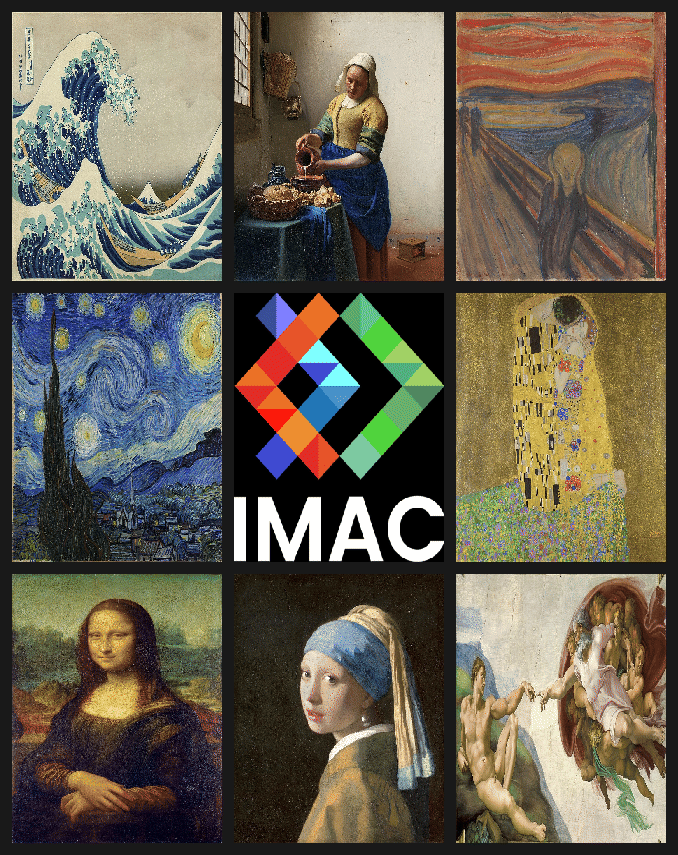
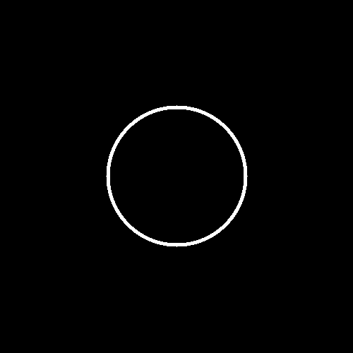
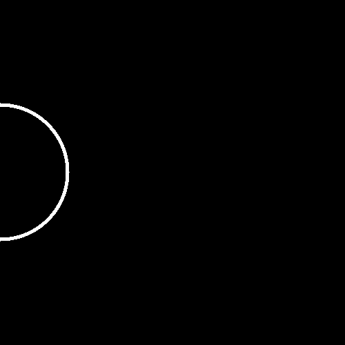
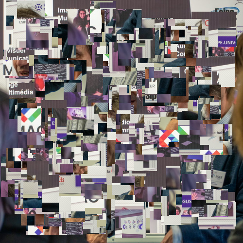
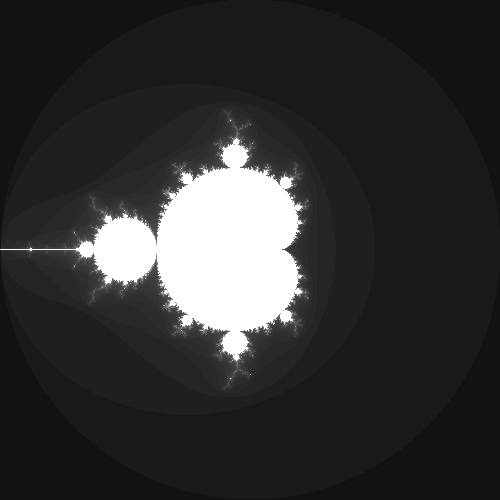
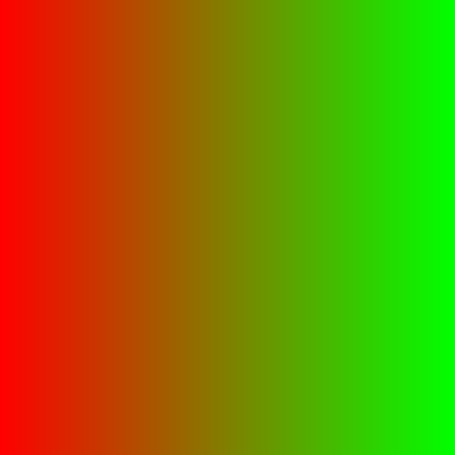
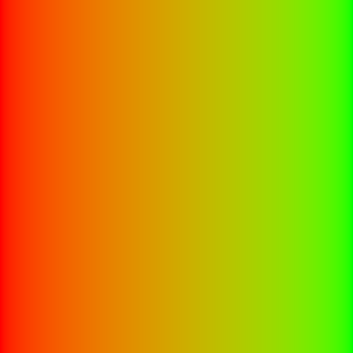
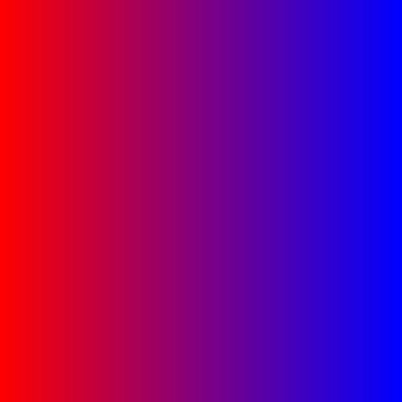
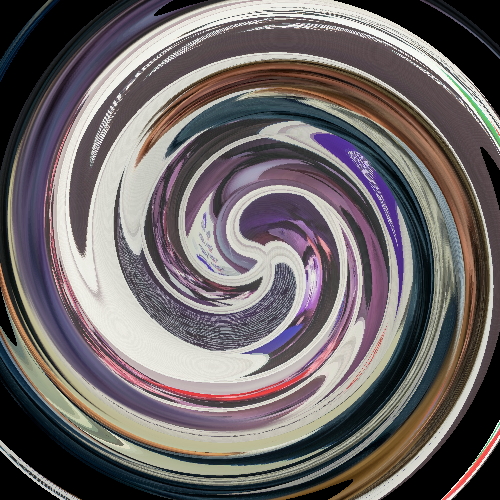
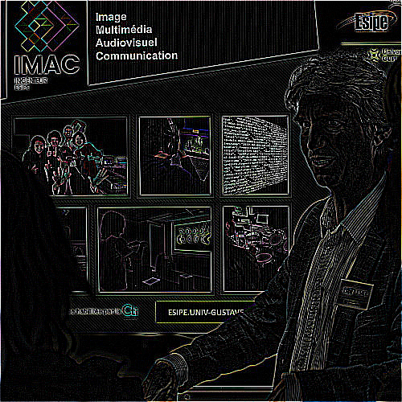

# Workshop - Baptiste SAEGAERT

## ⭐ Ne garder que le vert

## ⭐ Échanger les canaux

## ⭐ Noir & Blanc

Pour ce filtre, j'ai utilisé la formule de la luminance, plutôt que de diviser chaque valeur par 3 pour l'appliquer respectivement au RVB de mon image. Cette moyenne est pondérée pour mieux correspondre à l'œil humain.

## ⭐ Négatif

## ⭐ Dégradé noir et blanc

## ⭐⭐ Miroir

J'ai utilisé la fonction `std::swap` pour ne pas avoir besoin de parcourir toute l'image ou de faire appel à une copie : je parcours la moitié de la largeur et j'échange le pixel `x` avec `width() - 1 - x`.

## ⭐⭐ Image bruitée

## ⭐⭐ Rotation de 90°

## ⭐⭐ RGB split

## ⭐⭐ Luminosité

| Luminosité +                              | Luminosité -                                |
| ----------------------------------------- | ------------------------------------------- |
|  |  |

## ⭐⭐⭐ Filtre Lucas

Cet effet permet de reconstruire n'importe quelle image d'arrivée en réutilisant uniquement les pixels d'une image source, sans en inventer ni en recolorier aucun. On associe simplement les pixels les plus sombres de la source aux zones les plus sombres de la cible, et ainsi de suite jusqu'aux plus clairs.

**Sous-étapes :**

1. Redimensionner (`resize`) l'image source à la taille de l'image d'arrivée pour avoir exactement le même nombre de pixels.
2. Trier les pixels de l'image source par luminance (`getLuminance`).
3. Initialiser un tableau `Slot` contenant pour chaque pixel : une luminance et un pointeur vers la position du pixel dans l'image finale.
4. Parcourir l'image d'arrivée pour remplir le tableau `Slot`, puis trier ce tableau par luminance.
5. Parcourir le tableau trié pour placer le `i`-ème pixel trié de la source dans la `i`-ème case triée de la cible.

_Le code C++ pour animer l'effet a été généré par IA_

## ⭐⭐(⭐) Disque

J'ai utilisé le théorème de Pythagore (`dx * dx + dy * dy`) pour colorier les pixels dont la distance au centre est inférieure au rayon, en comparant directement avec mon `radius` au carré

## ⭐⭐(⭐) Cercle

J'ai repris la même logique que pour le disque en ajoutant une épaisseur (`thickness`) : on ne colorie que les pixels compris entre `(radius - thickness)²` et `radius²`.

## ⭐⭐ Animation

J'ai exporté plusieurs images successives dans une boucle en décalant à chaque fois la position horizontale (`centerX`) de mon cercle, puis je les ai assemblées en GIF.

## ⭐⭐⭐ Rosace

J'ai dessiné un cercle au centre puis 6 autres autour en calculant leurs coordonnées avec `std::cos` et `std::sin` et un angle réparti sur $2\pi / 6$ (pour dessiner 6 cercles autour du central).

## ⭐⭐⭐ Tri de pixels

Plutôt que de créer une nouvelle image, j'ai réalisé que mon image était déjà stockée dans un `std::vector` : j'ai donc trié `image.pixels()` avec ma fonction `getLuminance()` pour classer les pixels du plus foncé au plus clair.

## ⭐⭐ Mosaïque

Pour ce filtre, j'ai fait une image `x` fois plus large et `y` fois plus haute selon le nombre d'images souhaité pour ma mosaïque. J'ai utilisé le modulo (`%`) pour répéter mon image sur une grille : dès lors que `x` est plus grand que `image.width()`, ma boucle repart du pixel `0` pour construire la mosaïque (idem en `y`).

## ⭐⭐⭐⭐ Mosaïque miroir

J'ai vraiment galéré pour celui-là : à la base, j'avais 4 conditions selon l'orientation et je n'arrivais pas à les combiner correctement. J'ai réalisé que je n'avais besoin que de deux conditions en réutilisant les modulos : on vérifie simplement si on est sur une ligne ou une colonne impaire, et si oui on inverse en `x` et/ou en `y` en conséquence.

## ⭐⭐⭐ Glitch

| Glitch                       | Glitch puzzle                              |
| ---------------------------- | ------------------------------------------ |
|  |  |

J'ai copié plusieurs petits rectangles à des positions aléatoires en bornant leur taille aux dimensions de l'image pour éviter tout dépassement. Je peux régler beaucoup de paramètres comme la taille et le nombre de glitchs : avec des valeurs moins aléatoires (uniquement de gros carrés), j'ai pu obtenir un effet « puzzle ».

## ⭐⭐⭐(⭐) Fractale de Mandelbrot

## ⭐⭐⭐(⭐) Dégradés dans l'espace de couleur sRGB vs Oklab

| Rouge → vert sRGB                                              | Rouge → vert Oklab                                               | Rouge → bleu sRGB                                             | Rouge → bleu Oklab                                              |
| -------------------------------------------------------------- | ---------------------------------------------------------------- | ------------------------------------------------------------- | --------------------------------------------------------------- |
|  |  |  |  |

Le dégradé n'a pas été complexe à coder mais il est plus lourd, car on écrit une fonction pour chaque conversion dans un sens puis dans l'autre (`sRGB → Linear RGB → Oklab`).

Je trouve qu'il rend effectivement mieux avec les couleurs en exemple, mais personnellement je préfère le dégradé sRGB du rouge vers le bleu : même s'il est plus sombre, je le trouve plus cohérent que de passer par une couleur plus claire.

## ⭐⭐⭐(⭐) Tramage

| Avant                      | Après                       |
| -------------------------- | --------------------------- |
|  |  |

## ⭐⭐⭐(⭐) Normalisation de l'histogramme

| Avant                                       | Après                                        |
| ------------------------------------------- | -------------------------------------------- |
|  |  |

J'ai cherché les luminances min et max de l'image puis étiré `[min, max]` vers `[0, 1]`.

> ⚠️ **Attention :** j'ai ajouté une condition pour éviter de traiter une image dont les valeurs min et max seraient identiques, afin d'éviter une division par `0`.

## ⭐⭐⭐⭐ Vortex

| Avant                      | Après                       |
| -------------------------- | --------------------------- |
|  |  |

## ⭐⭐⭐⭐ Convolutions

Une convolution calcule la nouvelle couleur de chaque pixel en faisant une moyenne pondérée de ses voisins selon une matrice appelée kernel (ici un _Box blur_ 5×5 où chaque case vaut `1/25`). Il faut bien lire depuis une **copie** de l'image pour ne pas fausser les pixels suivants, vérifier les bords et clamper le résultat dans `[0, 1]`.

| Avant                      | Box blur (5×5)                               |
| -------------------------- | -------------------------------------------- |
|  |  |

### ⭐ Netteté, Contours, etc.

| Emboss                                   | Outline                                    | Sharpen                                    |
| ---------------------------------------- | ------------------------------------------ | ------------------------------------------ |
|  |  |  |

## ⭐⭐⭐⭐⭐ K-means : trouver les couleurs les plus présentes dans une image

| Originale                      | 2 couleurs                                | 3 couleurs                                | 16 couleurs                                 |
| ------------------------------ | ----------------------------------------- | ----------------------------------------- | ------------------------------------------- |
|  |  |  |  |

J'ai choisi `k` couleurs de départ au hasard dans l'image selon le niveau de simplification voulu (2, 3 ou 16 couleurs), puis j'ai affiné ces couleurs sur 10 itérations en regroupant chaque pixel avec sa couleur la plus proche et en recalculant la moyenne de chaque groupe.

## ⭐⭐⭐⭐⭐ Filtre de Kuwahara (effet peinture à l'huile)

Pour obtenir l'effet peinture à l'huile, j'ai remplacé chaque pixel par la couleur moyenne du quadrant (parmi 4 autour de lui) ayant la plus faible variance — en lisant depuis une copie de l'image pour ne pas fausser les voisins et en ajustant `radius` pour équilibrer rendu et temps de calcul.
