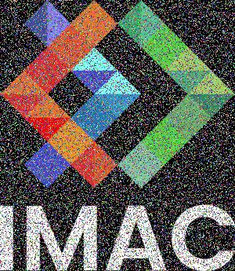
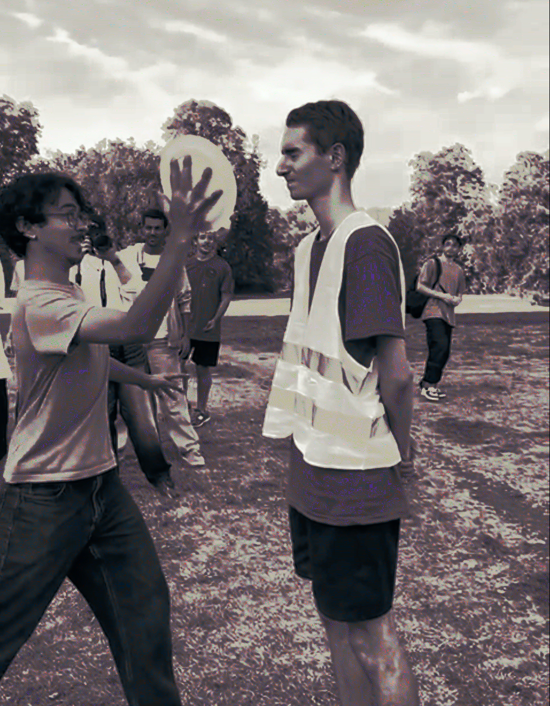
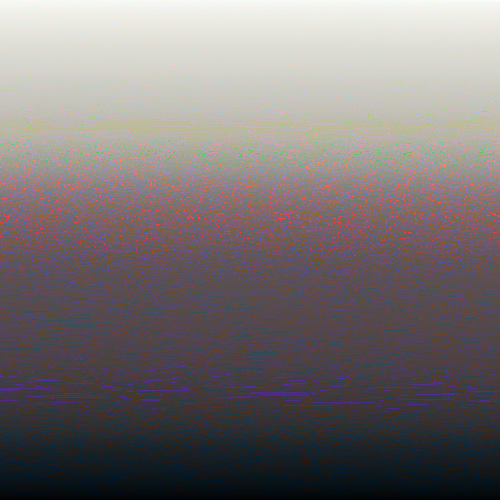

# Workshop - Baptiste SAEGAERT

## ⭐ Ne garder que le vert

## ⭐ Échanger les canaux

## ⭐ Noir & Blanc

## ⭐ Négatif

## ⭐ Dégradé

## ⭐⭐ Miroir

## ⭐⭐ Image bruitée

## ⭐⭐ Rotation de 90°

## ⭐⭐ RGB split

## ⭐⭐ Luminosité

## ⭐⭐⭐ Filtre Lucas

## ⭐⭐⭐ Tri de pixels

