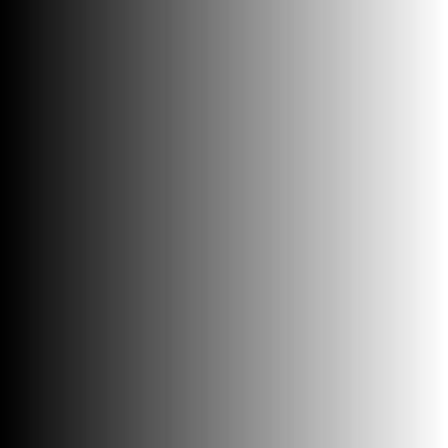
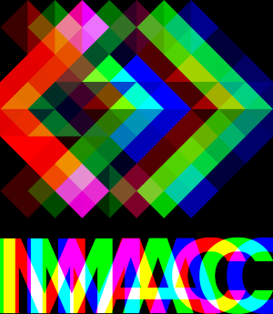
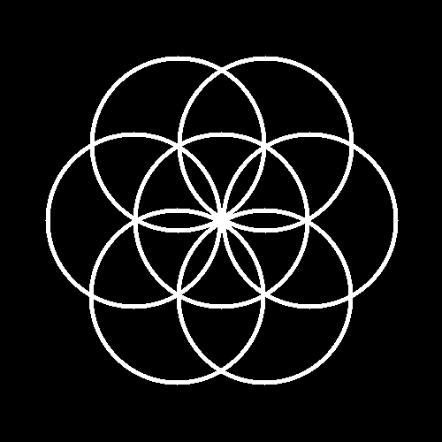
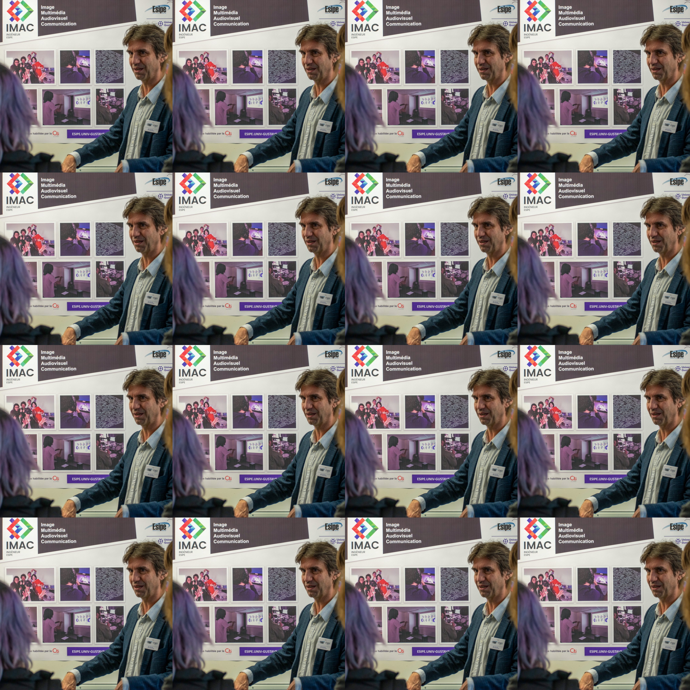
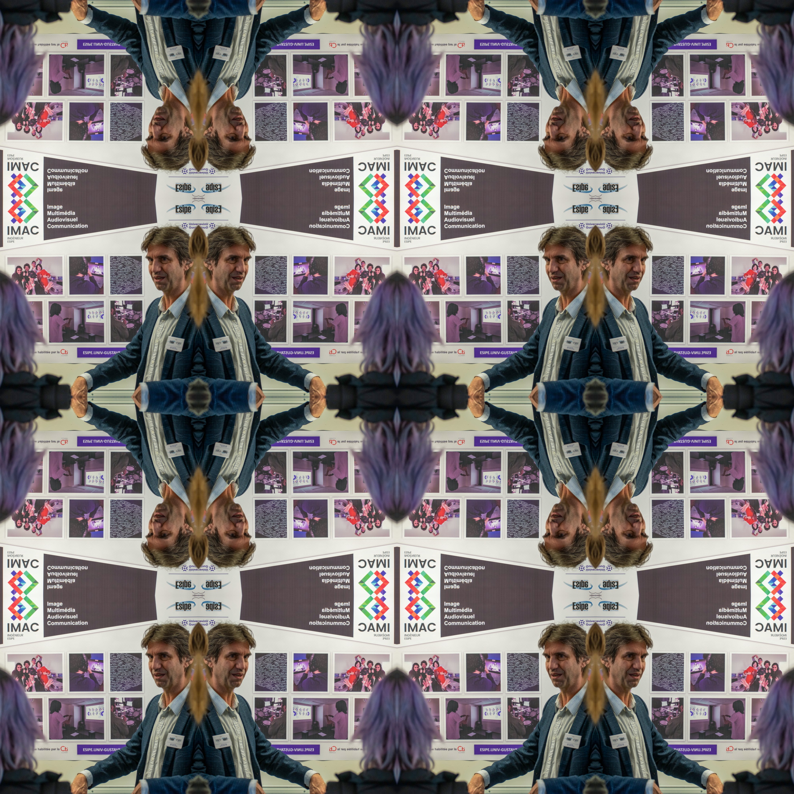
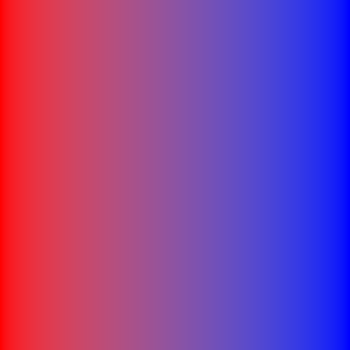

# Workshop - Baptiste SAEGAERT

## ⭐ Ne garder que le vert

## ⭐ Échanger les canaux

## ⭐ Noir & Blanc

## ⭐ Négatif

## ⭐ Dégradé noir et blanc

## ⭐⭐ Miroir

## ⭐⭐ Image bruitée

## ⭐⭐ Rotation de 90°

## ⭐⭐ RGB split

## ⭐⭐ Luminosité

## ⭐⭐⭐ Filtre Lucas

## ⭐⭐(⭐) Disque

## ⭐⭐(⭐) Cercle

## ⭐⭐ Animation

## ⭐⭐⭐ Rosace

## ⭐⭐⭐ Tri de pixels

## ⭐⭐ Mosaïque

## ⭐⭐⭐⭐ Mosaïque miroir

## ⭐⭐⭐ Glitch

## ⭐⭐⭐(⭐) Fractale de Mandelbrot

## ⭐⭐⭐(⭐) Dégradés dans l'espace de couleur sRGB vs Oklab

| Rouge → vert sRGB | Rouge → vert Oklab | Rouge → bleu sRGB | Rouge → bleu Oklab |
| --- | --- | --- | --- |
|  |  |  |  |

## ⭐⭐⭐(⭐) Tramage

| Avant | Après |
| --- | --- |
|  |  |

## ⭐⭐⭐(⭐) Normalisation de l'histogramme

| Avant | Après |
| --- | --- |
|  |  |

## ⭐⭐⭐⭐⭐ K-means : trouver les couleurs les plus présentes dans une image

| Originale | 2 couleurs | 3 couleurs | 16 couleurs |
| --- | --- | --- | --- |
|  |  |  |  |

## ⭐⭐⭐⭐⭐ Filtre de Kuwahara (effet peinture à l'huile)

